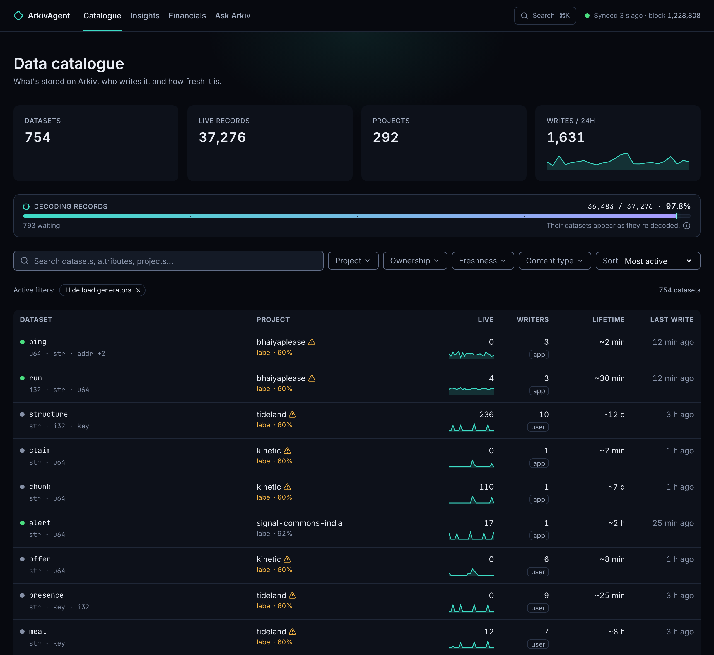
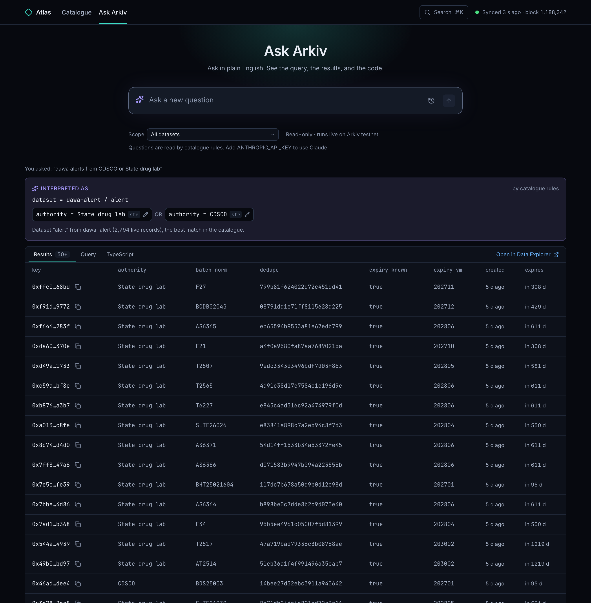

# ArkivAgent

A live map of what is stored on [Arkiv](https://arkiv.network): which projects write data, what their
datasets look like, who owns them, and how fresh they are. Ask questions in plain English and get the
query, the results and the SDK code.



## What it is

Arkiv is Golem's queryable data layer: apps write records (entities) with typed attributes, a payload
and an expiry. Golem's Block Explorer and Data Explorer show blocks, wallets and single records. ArkivAgent
shows the level above that: **projects and datasets**.

- **Data catalogue.** Groups records into datasets by project label and record kind, infers each schema
  (types, examples, how often each attribute is set), and shows live counts, writers, ownership (app,
  user or mixed), lifetimes and recent activity. It flags labels used by unrelated wallets, and hides
  Arkiv's own load generators by default. Each dataset page has the SDK code to read it back and a
  Data Explorer link that runs the same query.
- **Ask Arkiv.** Turns a question ("tideland parcels with x greater than 20") into a typed Arkiv query
  from the catalogue's schema, runs it live, and shows the query, the results, the TypeScript and a Data
  Explorer link. Each condition is a chip you can edit or remove without asking again.
  - **No guessing.** Words it couldn't use are listed as "Not used". Questions it can't ground ("every
    record on Arkiv") are refused with the reason.
  - **No unchecked queries.** Every query is validated and built with the SDK's own builders before it runs.
- **Insights.** Active wallets, active projects, writes and new projects over time, retention by
  cohort (week of first write), and the most active projects, with load generators left out unless you
  include them.
- **Financials.** What writing to Arkiv costs: a fee model fitted to sampled transaction receipts, a
  calculator for writes × payload × lifetime with its error range, and estimated GLM spend per project.
  Amounts are in GLM, with a dollar figure from the mainnet GLM price (see [Outbound calls](#outbound-calls)).
- **Feels live.** A local indexer follows the chain head and the UI updates within seconds, without a
  refresh. A sync indicator always says how fresh the data is ("Synced 3 s ago · block 1,188,342"), and
  says so when the index stops moving.
- **Read-only.** ArkivAgent holds no wallet and writes nothing to Arkiv. It runs on your machine against
  Arkiv's public Tiramisu testnet.



| Feature | Status |
|---|---|
| Data catalogue | Built |
| Ask Arkiv | Built |
| Insights | Built (stretch; differences from `design/05-pulse.md` under [Known gaps](#known-gaps)) |
| Financials | Built (stretch; needs `pnpm fees`; differences from `design/06-cost.md` under [Known gaps](#known-gaps)) |

## Run it locally

Needs Node 22.10+, pnpm 11 (`corepack enable`), and about 1 GB of disk for the index. No keys.

```bash
cp .env.example .env
pnpm install
```

Then, in one terminal, build the index and keep it following the chain:

```bash
pnpm index --watch
```

In a second terminal, start the app at http://localhost:3101:

```bash
pnpm dev
```

The first run replays Arkiv from block 1 (about 4 minutes), then decodes every live record's attributes
(about 2 hours on the public RPC). The catalogue fills in as decoding progresses, and says how many
records are still waiting. Stop the indexer whenever you like: it resumes where it left off.

The Financials page and the Insights page's GLM tile need fees, which the index doesn't hold. Once the replay
from block 1 has finished, sample them from transaction receipts (1,500 by default, about 10 minutes
beside the indexer; safe to re-run):

```bash
pnpm fees
```

The Insights and Financials pages show results the indexer works out and stores: after `pnpm index`,
every 30 seconds with `--watch`, and after `pnpm fees` (which refits the fee model). The pages only
read them, so they load in milliseconds whatever the size of the index. Until the indexer has stored
them once, the pages say so.

`pnpm index` without `--watch` syncs once and exits. The app still works, and the sync indicator says
"index not updating" until the indexer runs again.

For a production build: `pnpm build`, then `pnpm start`.

## Settings

All optional. ArkivAgent runs with the `.env.example` defaults.

| Variable | What it does |
|---|---|
| `ANTHROPIC_API_KEY` | Switches on Claude. Ask Arkiv reads questions with Claude (still checked against the catalogue) instead of the built-in rules, and each dataset page gets a short AI summary, cached per schema. `pnpm describe --limit 20` writes summaries ahead of time. Without the key, every feature works; dataset pages say "No AI summary yet". |
| `ARKIV_API_KEY` | Arkiv Hub access key (hub.arkiv.network/api-keys). Raises the public RPC limits, so the first decode is much faster. |
| `ARKIV_RPS` | Indexer decode rate in requests per second (default 8, or 25 with `ARKIV_API_KEY`). |
| `GLM_PRICE` | `off` stops the GLM/USD price lookups (see [Outbound calls](#outbound-calls)); the Financials page then shows GLM only. |
| `ARKIV_FEE_RPS` | `pnpm fees` rate in requests per second (default 3, to leave the indexer its budget). |
| `DATABASE_URL` | Where the SQLite index lives (default `file:./data/arkiv-agent.db`). |
| `PORT` | App port (default 3101). |
| `ARKIV_AGENT_HOST`, `ARKIV_AGENT_ALLOWED_HOSTS` | Shell variables, not `.env`. ArkivAgent listens on 127.0.0.1 and answers to localhost names only. To open it to your network: `ARKIV_AGENT_HOST=0.0.0.0 ARKIV_AGENT_ALLOWED_HOSTS=my-laptop.local pnpm start`. |

## Commands

| Command | What it does |
|---|---|
| `pnpm index` / `pnpm index --watch` | Sync the index once / keep following the chain. |
| `pnpm fees [--limit N]` | Sample fees from the receipts of N recent writes (default 1,500) for the Financials page. Skips transactions it already has. |
| `pnpm aggregates` | Work out and store the Insights and Financials results now, without syncing. The indexer does this itself; this is for when it isn't running. |
| `pnpm index:verify --attrs 20` | Compare the index with the chain: live count, plus names, types and values of 20 random records. |
| `pnpm dev` | App with hot reload on http://localhost:3101. |
| `pnpm build`, `pnpm start` | Production build and server. |
| `pnpm test` | Unit tests and the Ask Arkiv question sets (no network, no keys). |
| `pnpm test:e2e` | Browser smoke tests. Run `pnpm build` first, and leave the port free: Playwright starts its own server and refuses to test one it didn't start (`E2E_REUSE_SERVER=1` overrides). The first time, run `pnpm --filter arkiv-agent exec playwright install chromium`. |
| `pnpm describe --limit 20` | Pre-generate AI summaries (needs `ANTHROPIC_API_KEY`). |

## How Ask Arkiv reads a question

Without a key, rules read the question against the catalogue:

- **Dataset.** The project label and record kind it names, then the stored values it mentions. Values are
  looked up in the whole index, not just the three examples per attribute the catalogue shows.
- **Conditions.** Comparisons ("over", "between", "at least"), units ("3 hours" against a `duration_min`
  attribute), yes/no attributes ("is false", "not historical"), presence ("without a parent_key"), places
  ("in Pune"), time windows on a dataset's own timestamp, expiry windows, and owner or creator addresses.
- **Anything else** is listed as "Not used" instead of dropped.

With `ANTHROPIC_API_KEY`, Claude does the reading. In both cases the attribute types come from the
catalogue, and the plan is validated and compiled with the SDK's query builders before anything runs.

Arkiv's query language has limits that Ask states rather than hides:

- Values are exact and case-sensitive.
- Creation time can't be filtered.
- There is no sort ("latest" is reported as not applied) and no count.
- There is no `EXISTS` or `!=` on Tiramisu yet. "Has x" is written as `x STARTSWITH ''` (text) or `x >= 0`
  (numbers), and "is not" as `NOT x = …`. Datasets told apart only by other attribute types would be
  browse-only, with the reason on their page.
- Across all datasets, only owner, creator or key lookups run.

Accuracy is measured by the question sets in `packages/ask/test` (`pnpm test` prints the scores). Blind
checks by a separate reviewer are in the mission records (`missions/2026-10-28-arkiv-agent/tasks/T06…`, `T15…`).

## Known gaps

Insights and Financials were built as stretch work. Compared with their designs:

- **Cost (`design/06-cost.md`):**
  - Observed spend has no period selector (it's fixed at 30 days).
  - The load-generator control is a link, not the always-visible toggle.
  - There's no stacked area chart of spend by project, and there are three tiles, not six.
  - The fee model shows gas against calldata only (not fee against lifetime and payload), and lifetime has no
    slider.
  - Spend is estimated from the fee model and each write's payload size, not summed from receipts.
- **Pulse (`design/05-pulse.md`):**
  - With load generators included there's one banner, not a chip by each affected number.
  - Cohort marks use "–" where the design has "·".
  - Under 768 px, tables scroll inside a container instead of becoming cards.
  - Cohorts come from data (first-write week), because no hackathon project list exists.
  - There's no GLM-from-receipts total and no weekly AI summary.
- **Tests:** browser tests are reliable on the production build (`pnpm build`, then `pnpm test:e2e`, the default).
  Against `pnpm dev` they're timing-sensitive.

## Safety

- **Read-only:** a public client with no wallet. The run API accepts a validated plan, never a query string.
- **Local by default:** binds 127.0.0.1. The APIs refuse cross-site and non-JSON requests, and every route
  refuses host names that aren't local (DNS rebinding).
- **On-chain text is data.** Names and values written by third parties are clipped before they reach the
  model. Links and addresses are removed from model output before it is shown. The model gets no keys
  and no wallet access.
- **Public data.** ArkivAgent shows records exactly as Arkiv stores them, attributes plus a 120-character
  payload preview. It adds nothing that isn't public on the chain.

### Outbound calls

Besides the Arkiv RPC (and Claude, only with `ANTHROPIC_API_KEY`), the server makes one other kind of
call: for the Financials page's dollar figures it fetches the mainnet GLM/USD price from CoinGecko
(`api.coingecko.com`), falling back to Binance's GLM/USDT ticker (`api.binance.com`). Tiramisu's testnet
GLM has no value of its own, so this only puts a real-world scale on the fees. The requests carry no
data from your index or your questions, but the providers see your IP address. A price is reused for
10 minutes, so there's at most one lookup every 10 minutes while you use the Financials page (one a minute
while both sources are down). Pages never wait for it: until a price arrives, and whenever neither source
answers, amounts are shown in GLM only.

The GLM/USD chart on the same page loads its history from the same two providers: Binance's GLMUSDT klines
(daily, or 4-hourly for 7 days), falling back to CoinGecko's market chart. The first view fetches the whole
range (90 days of daily closes cover the 30 and 90 day views); after that only the latest candle is
refreshed, at most every 10 minutes. Candles are kept in `glm-prices.db` next to the index, so the chart
still has its history after a restart or while the providers are down. `GLM_PRICE=off` turns off both
the price and the history lookups.

## Project layout

| Path | What it holds |
|---|---|
| `apps/arkiv-agent` | Next.js app: catalogue, dataset pages, Ask Arkiv, pulse, cost, APIs, Playwright tests. |
| `packages/core` | Arkiv client (retries, optional access key, abortable reads). |
| `packages/db` | Prisma schema and migrations for the SQLite index. |
| `packages/indexer` | Event sync, attribute decoding, change feed, stored Insights and Financials results, `index:verify`, `pnpm fees`. |
| `packages/catalogue` | Dataset inference, schemas, ownership, SDK snippets, AI summaries, index value lookup. |
| `packages/ask` | Question to query: rules, Claude path, compiler, live runner, question sets. |
| `packages/projects` | Which project each wallet writes for, and which wallets are load generators. |
| `packages/pulse` | Daily activity, retention cohorts and most active projects, from the index. |
| `packages/cost` | Fee model (fit, hold-out range, calculator) and estimated spend. |
| `arkiv/schema.md`, `arkiv/friction.md` | What ArkivAgent reads from Arkiv, and what was hard. |
| `docs/PLAN.md`, `design/` | Technical design and UX specs. |
| `docs/demo.md` | A 3-minute demo script. |

ArkivAgent reads Arkiv's public testnet. Not affiliated with Golem.

## License

[MIT](LICENSE) © 2026 Digital 7 Ltd.
